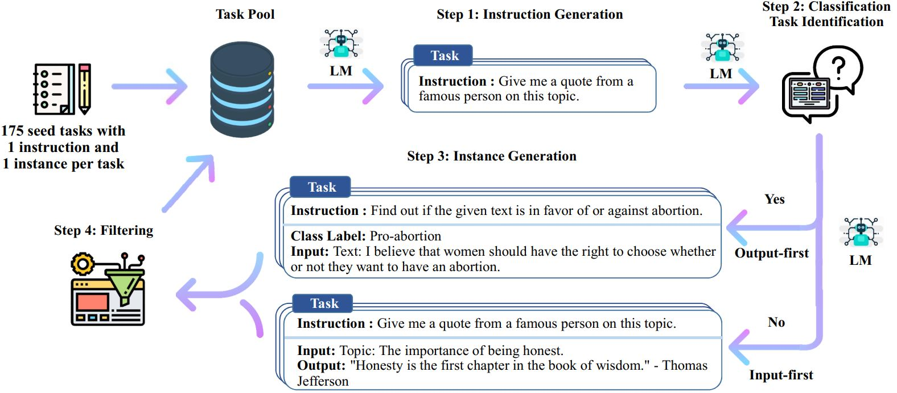

# Project README: Task Generation and Fine-Tuning Data Preparation

Due to recent updates in the OpenAI API, the original source code became outdated. The code has been updated to ensure compatibility and functionality. This README outlines the process of generating tasks, classifying them, creating instances, and preparing data for fine-tuning, as described below.

## Overview
The workflow involves generating machine-based tasks from a seed task, classifying them as classification or generation tasks, generating instances for these tasks, and preparing the data in a format suitable for fine-tuning a GPT model. The process consists of four main steps, detailed below.

## Step 1: Task Generation
- **Description**: Using the `bootstrap_instructions.py` script, 175 tasks are generated based on a seed task. The script samples tasks according to the `--num_prompt_instructions` parameter.
- **Prompt Design**:
  - For classification tasks:
    ```python
    prompt = "Come up with a series of classification tasks. Try to specify the possible output labels when possible.\n"
    ```
  - For non-classification (generation) tasks:
    ```python
    prompt = "Come up with a series of tasks:\n"
    ```
- **Process**:
  - The script sends batch requests to the GPT model using the designed prompts.
  - The response is stopped using the following stop sequences: `["\n\n", "\n16", "16.", "16 ."]`.
  - If `--num_prompt_instructions=8`, up to 15 tasks are sampled, and the machine generates a maximum of `7 * batch_size` tasks.
- **Output**: A file named `machine_generated_instructions.jsonl` containing the machine-generated tasks.

## Step 2: Task Classification
- **Description**: Using the `identify_clf_or_not.py` script, the tasks in `machine_generated_instructions.jsonl` are classified as either classification or generation tasks.
- **Template**:
  - The classification is based on a manually designed template (`template_1`) from `clf_task_template.py`.
- **Process**:
  - The script analyzes each task to determine its type (binary classification: classification vs. generation).
- **Output**: A file named `is_clf_or_not_davinci-002_template_1.jsonl` containing the classification results.

## Step 3: Instance Generation
- **Description**: Using the `generate_instances.py` script, instances are generated for the tasks based on templates from `instance_gen_template.py`.
- **Templates**:
  - For classification tasks: `output_first_template_for_clf`.
  - For generation tasks: `input_first_template_for_gen`.
- **Process**:
  - Similar to Step 1, requests are created by appending the task requiring completion to the prompt.
  - For classification tasks, the template prioritizes outputting the class label followed by the input.
  - For generation tasks, the input is prioritized.
- **Output**: A file named `machine_generated_instances.jsonl` containing the generated instances.

## Step 4: Data Preparation for Fine-Tuning
- **Description**: Using the `prepare_for_finetuning.py` script, the generated instances are processed into a user-friendly format and a final dataset for fine-tuning.
- **Process**:
  - The script generates `all_generated_instances.jsonl`, which is easy to understand.
  - It also creates `gpt3_finetuning_data_243.jsonl`, formatted for GPT fine-tuning.
  - **Data Format**:
    - **Prompt**: Contains the user-defined instruction and input.
    - **Completion**: Contains the model-predicted output (e.g., class label for classification tasks or generated text for generation tasks).
    - For classification tasks, the class label becomes the completion, while the instruction and input form the prompt.
    - For generation tasks, the response is reordered to ensure the instruction and input are in the prompt, and the generated output is the completion.
  - **Example Format** (first two lines of `gpt3_finetuning_data_243.jsonl`):
    ```json
    {"prompt": "Task: Complete the paragraph given its prefix.\nInput: During 2021, interest and investment in fintech grew significantly in many regions of the world \u2014 its scope broadening well-beyond its early definition.\nOutput:", "completion": " This expanding scope, combined with the growing maturity of a number of fintech subsectors, increasing investment in less mature jurisdictions, and surging corporate interest, is expected to keep investment high as we enter 2022. Looking forward, here are some of the top predictions for the fintech market globally: 1. Growing number of banks will offer embedded solutions; 2. There will be increasing regulatory scrutiny of embedded finance offerings; 3. Fintechs will focus on branding themselves as data organizations; 4. ESG-focused fintechs will have a big growth trajectory; 5. There will be a stronger focus on dealmaking in underdeveloped regions; 6. Unicorn status will lose some of lustre in developed markets, remain key in emerging ones.<|endoftext|>"}
    {"prompt": "Given a set of numbers, find all possible subsets that sum to a given number.\n\nSet: {3,12,7,2,8,4}\nTarget sum: 14\n\nOutput:", "completion": " {12,2}, {7,3,4}, {8,2,4}<|endoftext|>"}
    ```
- **Note**:
  - The `output_first_template_for_clf` and `input_first_template_for_gen` templates do not require deep understanding. For classification tasks, the class label is output first, followed by the input. In the final fine-tuning data (`gpt3_finetuning_data_243.jsonl`), the class label becomes the completion, and the instruction and input become the prompt.
  - For generation tasks, the response may need reordering to ensure the instruction and input are in the prompt, and the generated output is the completion.

## Key Notes
- The fine-tuning data format ensures that all user-defined content (instructions and inputs) is in the `prompt`, and all model-predicted content is in the `completion`.
- The process is designed to handle both classification and generation tasks, with templates ensuring consistency in the output format.
- The code has been updated to address OpenAI API changes, ensuring compatibility and successful execution.


# The following is the original author's README


# Self-Instruct: Aligning LM with Self Generated Instructions

This repository contains code and data for the [Self-Instruct paper](https://arxiv.org/abs/2212.10560), a method for aligning pretrained language models with instructions.

## Introduction

Self-Instruct is a framework that helps language models improve their ability to follow natural language instructions. It does this by using the model's own generations to create a large collection of instructional data. With Self-Instruct, it is possible to improve the instruction-following capabilities of language models without relying on extensive manual annotation.

### Background

In recent years, there has been a growing interest in building models that can follow natural language instructions to perform a wide range of tasks. These models, known as "instruction-tuned" language models, have demonstrated the ability to generalize to new tasks. However, their performance is heavily dependent on the quality and quantity of the human-written instruction data used to train them, which can be limited in diversity and creativity. To overcome these limitations, it is important to develop alternative approaches for supervising instruction-tuned models and improving their instruction-following capabilities.

### How Self-Instruct works?

The Self-Instruct process is an iterative bootstrapping algorithm that starts with a seed set of manually-written instructions and uses them to prompt the language model to generate new instructions and corresponding input-output instances. These generations are then filtered to remove low-quality or similar ones, and the resulting data is added back to the task pool. This process can be repeated multiple times, resulting in a large collection of instructional data that can be used to fine-tune the language model to follow instructions more effectively.

Here is an overview of Self-Instruct:



## Usage

\* **This work is still in progress. We may update the code and data as we make progress. Please be cautious about the version control.**

### Instruction-tuning using our Self-Instruct data

We release a dataset that contains 52k instructions, paired with 82K instance inputs and outputs. This instruction data can be used to conduct instruction-tuning for language models and make the language model follow instruction better. The entire model-generated data can be accessed in `data/gpt3-generations/batch_221203/all_instances_82K.jsonl`. This data (+ the 175 seed tasks) reformatted in clean GPT3-finetuning format (prompt + completion) is put in `data/finetuning/self_instruct_221203`. You can use the script in [`./scripts/finetune_gpt3.sh`](./scripts/finetune_gpt3.sh) to finetune GPT3 on this data.

**Note**: This data is generated by a language model (GPT3) and inevitably contains some errors or biases. We analyzed the data quality on 200 random instructions in our paper, and found that 46% of the data points may have problems. We encourage users to use this data with caution and propose new methods to filter or improve the imperfections.

### Evaluating instruction-following capabilities

We also release a new set of 252 expert-written tasks and their instructions motivated by user-oriented applications (rather than well-studied NLP tasks). This data is used in the human evaluation section of [the self-instruct paper](https://arxiv.org/abs/2212.10560). Please refer to [the human evaluation README](human_eval/README.md) for more details.

### Generating Self-Instruct data from scratch

To generate Self-Instruct data using your own seed tasks or other models, we open-source our scripts for the entire pipeline here. Our current code is only tested on the GPT3 model accessible via the [OpenAI API](https://beta.openai.com/docs/models/gpt-3).

Here are the scripts for generating the data:

```bash
# 1. Generate instructions from the seed tasks
./scripts/generate_instructions.sh

# 2. Identify whether the instruction represents a classification task or not
./scripts/is_clf_or_not.sh

# 3. Generate instances for each instruction
./scripts/generate_instances.sh

# 4. Filtering, processing, and reformatting
./scripts/prepare_for_finetuning.sh
```

## Citation

If you use the Self-Instruct framework or data, feel free to cite us.

```bibtex
@misc{selfinstruct,
  title={Self-Instruct: Aligning Language Model with Self Generated Instructions},
  author={Wang, Yizhong and Kordi, Yeganeh and Mishra, Swaroop and Liu, Alisa and Smith, Noah A. and Khashabi, Daniel and Hajishirzi, Hannaneh},
  journal={arXiv preprint arXiv:2212.10560},
  year={2022}
}
```
